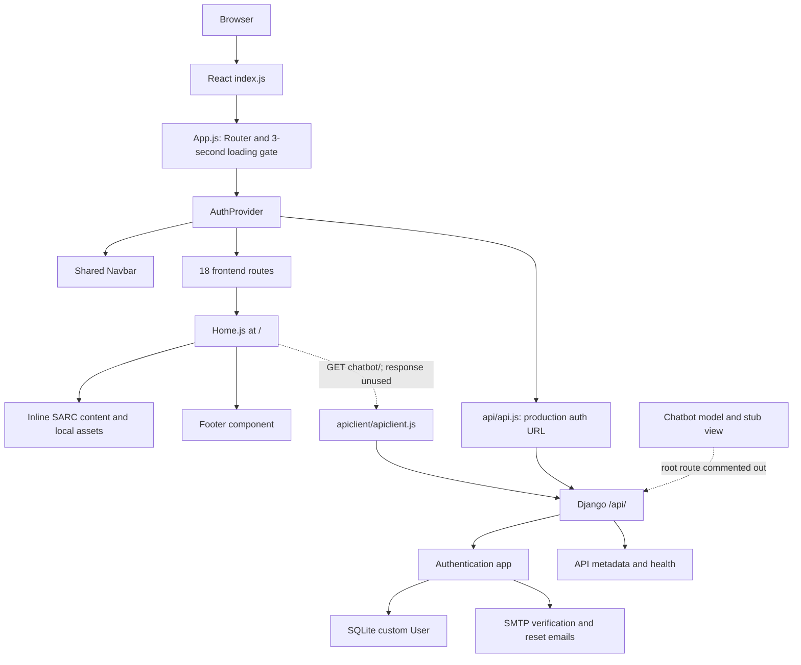

# SARC Centralised — Repository Architecture and Homepage Rebuild Boundaries

Prepared 22 October 2026. Status: architecture checkpoint retained. The homepage implementation is in `centralised-frontend/src/pages/Home.js`; the Expo app is in `sarc-native/`.

## 1. Scope and source of truth

Repository: [2kri5h/krish-centralised](https://github.com/2kri5h/krish-centralised). Analysed branch: `Krish`, the GitHub default branch at inspection. Snapshot: `24157bd5c8a37dada83992f854bd5970e6f6b104`.

The requested eventual change is the **whole homepage at `/` only**, adapted to SARC's identity with Creighton's alumni website as a reference. This document first explains the existing repository, its dependencies and constraints. It records a technical work sequence and preliminary reference observations; it does not select a new palette, approve a layout, or implement a redesign.

The checkout contains 366 tracked files. This review mapped both application roots, frontend routing and content, shared UI, authentication, backend routing/models, assets, build configuration, and deployment scripts. Bundled Django/DRF static vendor code was classified as framework output rather than treated as application business logic.

Evidence is static source inspection unless explicitly labelled otherwise. The deployed SARC application was not exercised, production data was not accessed, and no build or test pass is claimed.

## 2. Executive architecture

This is a two-application repository: a React single-page frontend and a Django REST backend. It is not a Next.js application and has no server-rendered React layer. Public homepage content is largely embedded in JavaScript. The backend mainly implements account registration, verification, login, profile, and password operations.



The imported source currently contains unresolved merge conflicts, including in `Home.js` and `Navbar.js`. Accordingly, the diagram describes intended wiring present in the source, not a successfully running snapshot.

## 3. Repository map

```text
repository/
├── README.md                         minimal root introduction
├── .gitignore                        frontend/backend ignores; also ignores Poetry metadata/migrations
├── docker-compose.yaml               two services and an external Docker network
├── ashwani_prod.txt                   operational note; not a frontend entry point
├── centralised-frontend/
│   ├── package.json                   CRA commands and declared dependencies
│   ├── package-lock.json, yarn.lock   two package-manager lockfiles
│   ├── Dockerfile, start.sh           frontend development-server startup
│   ├── tailwind.config.js             content scanning; empty theme extension
│   ├── postcss.config.js              Tailwind and Autoprefixer
│   ├── public/                       HTML shell, manifest, icons and public imagery
│   └── src/
│       ├── index.js, index.css        React root, global CSS, default axios base URL
│       ├── App.js                     app loading gate and route table
│       ├── App.css, globals.css       additional styles; not imported by active entry/App
│       ├── App.test.js, setupTests.js, reportWebVitals.js
│       ├── pages/                     public pages and account pages
│       │   ├── Home.js, Home.css      current homepage and unimported companion CSS
│       │   ├── Home copy.js           alternate homepage; not routed by App.js
│       │   ├── Initiatives.js/.css, Gallery.js/.css
│       │   ├── AboutUs.js, Alum.js, Blogs.js, JoinUs.js, UpcomingEvents.js
│       │   ├── Contact.js             placeholder; /contact uses components/Contact instead
│       │   ├── Login.js/.css, Signup.js, Profile.js/.css
│       │   ├── ForgotPassword/        parallel .js and .jsx implementations
│       │   ├── ChangePassword/
│       │   └── verification pages    VerifyEmail, DirectVerify, VerifyPage, VerificationSuccess
│       ├── components/
│       │   ├── Navbar/                global navigation and external program links
│       │   ├── Footer/                homepage footer, contact and social links
│       │   ├── Contact/               routed contact/team page
│       │   ├── IfIKnewThen/           alumni advice dataset and chapter UI
│       │   ├── Loading/               simulated progress screen
│       │   ├── AuthButtons/           additional auth UI
│       │   ├── HealthCheck/           standalone API status component
│       │   └── Chatbot/               disabled-message component
│       ├── context/AuthContext.js     session state and login/logout operations
│       ├── api/api.js                 absolute production authentication requests
│       ├── apiclient/apiclient.js     separate axios instance and interceptors
│       ├── services/apiService.js     optional cached API discovery helper
│       └── assets/                    logo, illustrations, team photos and gallery/speaker photos
└── Centralised-Backend/
    ├── manage.py                      selects sarc_backend.settings
    ├── sarc_backend/                   active settings, root URLs, WSGI/ASGI
    ├── Centralised/settings.py        separate static configuration fragment; inactive entry target
    ├── Authentication/                User, serializers, views, URLs, admin, email helper
    ├── Chatbot/                       simple Q&A model and inactive fixed-response view
    ├── api_root/                      API metadata and health endpoints
    ├── templates/email/               verification and reset email templates
    ├── django_static/                 checked-in Django/DRF admin/static assets
    ├── Dockerfile, wsgi-entrypoint.sh  image setup and Gunicorn startup
    └── README.md                      setup notes, partly inconsistent with active settings
```

## 4. Frontend execution and routing

`src/index.js` imports `index.css`, sets a default axios base URL from `REACT_APP_API_URL`, and mounts `App` in `React.StrictMode`. `App.js` imports its route components eagerly. It mounts `BrowserRouter` and `AuthProvider`, then displays `Loading` for a fixed three seconds before showing `Navbar` and `Routes`. This delay is a timer, not actual asset readiness. See `src/index.js:1–21`, `src/App.js:25–70`, and `components/Loading/Loading.jsx:5–45`.

`Navbar` sits above `Routes`, so editing its markup or CSS affects every routed page. `Footer` is not an app-wide layout wrapper: `Home.js` imports and renders it itself. There is no wildcard fallback route in `App.js`.

| Route | Component/file under `src/` | Existing responsibility |
|---|---|---|
| `/` | `pages/Home.js` | Homepage; scope of eventual rebuild |
| `/initiatives` | `pages/Initiatives.js` | Inline initiative descriptions and interactive detail selection |
| `/alumni-advice` | `components/IfIKnewThen/IfIKnewThen.jsx` | Chapter-based alumni advice from local data |
| `/gallery` | `pages/Gallery.js` | Local-image gallery/lightbox source; conflicted |
| `/blogs` | `pages/Blogs.js` | Placeholder blog content |
| `/contact` | `components/Contact/Contact.jsx` | Team/contact content; conflicted |
| `/aboutUs` | `pages/AboutUs.js` | SARC introduction, vision, statistics and embedded `AlumniGrid` |
| `/alum` | `pages/Alum.js` | Placeholder alumni grid |
| `/join-us` | `pages/JoinUs.js` | Basic login/register form markup |
| `/upcomingEvents` | `pages/UpcomingEvents.js` | Placeholder events and registration buttons |
| `/profile` | `pages/Profile.js` | Context-backed profile; redirects unauthenticated users |
| `/login` | `pages/Login.js` | Login and verification resend; conflicted |
| `/signup` | `pages/Signup.js` | Registration; conflicted |
| `/verify/:uid/:token` | `pages/VerifyEmail.js` | Email verification request and status |
| `/direct-verify/*` | `pages/DirectVerify.js` | Alternative verification path |
| `/forgot-password` | `pages/ForgotPassword/ForgotPassword.js` | Reset-email form |
| `/reset-password/:uid/:token` | `pages/ForgotPassword/ResetPassword.js` | New-password form |
| `/changePassword` | `pages/ChangePassword/ChangePassword.jsx` | Password-change form |

Source: `App.js:4–23,46–63`. Extensionless imports select the existing `.js` password pages; the similarly named `.jsx` alternatives should not be mistaken for the routed implementation. `VerifyPage.js` and `VerificationSuccess.js` also exist but are not registered in this route table.

## 5. Current homepage internals

`pages/Home.js` is 1,430 lines, including helper components, content, animation calculations and page markup. `Home` itself spans lines 543–1428. This is the main replacement boundary.

| Source region | Existing content/behavior | Architectural implication |
|---|---|---|
| 36–148 | Multilingual greetings, six initiative records, testimonials | Content and presentation are coupled |
| 150–541 | Stats/events/grid/testimonial/alumni helper components | Definitions are not evidence that each helper is part of the final rendered page |
| 543–654 | State, refs, typewriter, Framer Motion transforms and about/alumni visibility | Multiple scroll-driven state machines |
| 656–680 | `GET chatbot/`, greeting interval, testimonial interval | API response is assigned to `data` but not used in the returned content |
| 685–763 | Twelve speaker records and image imports | Local editorial content, not an alumni API |
| 781–870 | Hero scroll phases and imperative resize/DOM changes | Behavior depends on browser dimensions and absolute scroll position |
| 885–1060 | Long hero with competing merge-conflict variants | Final intended hero cannot be established until conflicts are resolved |
| 1062–1191 | Sticky horizontal initiative sequence | Uses a 600vh scroll section and wide cards |
| 1195–1278 | SARC intro and statistics | Copy visibility depends on scroll; statistics are hardcoded |
| 1281–1326 | Past-speaker horizontal sequence | Uses a 400vh scroll section with biography cards |
| 1331–1423 | Auto-advancing testimonials with arrows | Duplicates local testimonial records for visual looping |
| 1425 | Footer | Footer ownership stays inside homepage |

The hero source uses a 400vh minimum and an additional 400vh spacer. Intro and speaker sections also use large viewport-height regions, sticky/fixed positioning and opacity gates. These are observations of intended source behavior, not measurements of a working deployment.

The current content theme is connection between IIT Bombay students and alumni: mentorship, internships, community events, advice and speakers. Source statistics differ across pages: Home shows 14,000+ students, 70,000+ alumni and 30+ events; AboutUs prose mentions 12,000+, 65,000+ and 50+, while its stat blocks differ again. Treat all figures, biographies, testimonials and contacts as editorial material requiring confirmation before publication.

Homepage links also need review: initiative CTAs hardcode the production domain, and the hero's `Learn More` button has no handler in the inspected variant. A rebuilt homepage should keep internal navigation within the SPA using the existing route contracts.

## 6. Styling and assets

The active global stylesheet is `index.css`, with Tailwind directives and a system font stack. Tailwind scans `src/**/*.{js,jsx,ts,tsx}` and `public/index.html`; its theme extension is empty. `postcss.config.js` enables Tailwind and Autoprefixer. Tailwind 3.4.17 appears in `package-lock.json`, although it is not a direct dependency in `package.json`.

Most homepage styling is in utility classes and inline objects. Existing source uses black/dark surfaces, orange accents, blue/cream elements elsewhere, and multiple gradients. These are existing implementation colours, not an approved SARC brand system. No shared semantic colour, spacing or typography token system is established in the inspected Tailwind configuration.

`Home.js` does **not** import `Home.css`. The latter contains broad selectors such as `.flex`, `.sticky`, `section`, `html` and `body`; importing it during redesign could change unrelated routes. `globals.css` and `App.css` likewise are not imported from the current entry/App path. `Navbar.css` and `Footer.css` are loaded by their respective components and remain global CSS. Footer CSS imports Poppins from Google Fonts.

Reusable asset locations:

- `src/assets/logo.png`: imported by navbar/loading UI.
- `src/assets/`: SARC illustrations, icons and supporting graphics.
- `src/assets/gallery/gallery/`: event/gallery imagery, including mixed filename case.
- `src/assets/gallery/gallery/Alumni/`: twelve speaker portraits imported by Home.
- `src/assets/ctm/`: team portraits used by contact content.
- `public/`: additional illustrations, favicon/logo and HTML shell.

Asset availability is established by filesystem inventory/imports; visual suitability, compression, crop quality, rights and current branding have not yet been audited. Preserve filename case for Linux builds. The HTML shell sets a SARC title/description but currently disables user zoom via viewport attributes (`public/index.html:7`).

## 7. Data access and authentication

There are three overlapping API patterns:

| Layer | Base/configuration | Role |
|---|---|---|
| Default axios in `index.js` | `REACT_APP_API_URL` or empty string | Affects requests made through default axios |
| `apiclient/apiclient.js` | Production `/api/`; development `https://centralised.sarc-iitb.org/api/` | Separate instance, JSON headers, Bearer token and CSRF interceptors, request/response logging |
| `api/api.js` | Absolute `https://centralised.sarc-iitb.org/api/auth/` | Login, registration, profile helper, password/reset and verification helpers |

Changing the environment variable alone does not redirect all requests: absolute URLs and the separately configured axios instance bypass it. `services/apiService.js` provides cached discovery via `/api/` and a login helper; it is not the app's central transport abstraction.

`AuthContext` restores `token` and `user` from localStorage. Login stores `token`, `refreshToken`, and `user`; logout clears these and navigates to `/login`. Navbar also contains competing local `access_token` logic in its unresolved variants. Preserve account flows and test signed-in/signed-out navigation when later replacing homepage chrome. Do not silently redesign the authentication contract as part of homepage work.

Home does not need an authenticated backend to render its local content. Its existing chatbot request is not a valid content-service dependency: the root backend route is disabled and the assigned response is not rendered. No implemented homepage CMS/event/news feed was found in the inspected first-party backend route/model scope. Adding live news, event registration, search or a CMS would be a separate feature decision.

## 8. Backend architecture and contracts

`manage.py:5–10`, WSGI and ASGI select `sarc_backend.settings`. That settings module installs Django, DRF, SimpleJWT, OAuth Toolkit, CORS, `Authentication`, `Chatbot` and `api_root`. `Centralised/settings.py` is a separate fragment, not the selected module.

Active persistence is SQLite at `BASE_DIR/db.sqlite3` (`sarc_backend/settings.py:152–158`). PostgreSQL settings are commented out. The root URL configuration mounts `/admin/`, `/api/`, `/api/auth/`, and OAuth routes. The Chatbot include is commented out (`sarc_backend/urls.py:6–14`).

| Endpoint | Responsibility |
|---|---|
| `GET /api/` | Static API metadata/discovery response |
| `GET /api/health/` | Constant health response; does not probe database/email dependencies |
| `POST /api/auth/?action=login` | Email/password login; rejects unverified users; returns JWTs and user |
| `POST /api/auth/?action=register-verify-email` | Creates unverified account and sends verification email |
| `GET /api/auth/verify/<uid>/<token>/` | Validates token, marks verified and redirects to production login |
| `POST /api/auth/resend-verification/` | Sends another verification email |
| `GET /api/auth/profile/` | JWT-authenticated user profile |
| `POST /api/auth/password/?action=change` | Authenticated password change |
| `POST /api/auth/password/?action=reset-password-email` | Sends reset link |
| `POST /api/auth/password/<uid>/<token>/` | Token-based password reset |
| `/o/`, `/o/token/` | OAuth Toolkit URLs |

Sources: `Authentication/urls.py:18–27`, `Authentication/views.py:17–243`, `api_root/urls.py:4–7`, `api_root/views.py:5–21`. A debug-verification route also exists in Authentication URLs; it is not a homepage integration point. No JWT refresh endpoint is mapped in the inspected root/auth URL files.

`Authentication/models.py:46–85` defines a custom email-identified `User` with name, optional phone/roll/hostel fields and verification/admin/active state. Its manager normalizes email and hashes passwords. Registration and profile serializers define the corresponding payloads. Profile view explicitly requires JWT and authenticated permission. Access tokens are configured for 60 minutes and refresh tokens for two days.

Email delivery uses `Authentication/utils.py` with SMTP/TLS; callers do not act on its failure return value. Settings/helper contain embedded sensitive configuration; values are deliberately omitted here. This is existing operational debt, not a requirement for the homepage rebuild.

`Chatbot/models.py:4–9` stores short question/answer strings. Its view returns a constant greeting and fixed event metadata rather than reading that model. The frontend Chatbot component displays a disabled message. These files do not establish a functioning conversational system or live events service.

## 9. Build, deployment and reproducibility

Frontend declared dependencies include React/ReactDOM `^18.3.1`, React Router `^7.1.5`, CRA/react-scripts `^5.0.1`, axios `^1.7.9`, Framer Motion `^12.5.0`, React Icons `^5.5.0` and react-simple-typewriter `^5.0.1`. These are manifest ranges, not assertions that these exact versions are installed. Commands are `npm start`, `npm run build`, and `npm test`; both npm and Yarn lockfiles are present.

Frontend Docker uses `node:16`, installs with `npm install`, and starts the CRA development server on port 3000. Compose publishes host 5024 to container 3000. `start.sh` instead exports `PORT=5024` and uses Yarn; it is not the Dockerfile CMD. The Compose frontend volume target differs from Docker's `/app` working directory, so it is not a straightforward live-source mount.

Backend Docker uses `python:3`, installs packages and Poetry, and expects `pyproject.toml`. That file and `poetry.lock` are absent from this checkout; `.gitignore` explicitly ignores both and backend migrations. A fresh backend Docker build cannot satisfy its manifest COPY from the supplied checkout. Exact intended Python dependency versions cannot be reconstructed from available metadata.

Compose overrides backend startup to `/Backend/wsgi-entrypoint.sh`, maps host 8017 to container 8000, and mounts source at `/Backend`. The script changes to `/Centralised-Backend`, then runs migrations/static collection and Gunicorn with four workers/four threads. The mounted and executed source paths differ. Active settings also lack the `STATIC_ROOT` shown in the unused settings fragment. Compose requires the external `yearbook23_mynetwork` network. Reverse-proxy configuration is not supplied in the tracked root configuration; same-origin `/api/` forwarding and SPA deep-link fallback remain deployment assumptions to verify.

The frontend test is a CRA starter assertion for a “learn react” link, unrelated to current page behavior. Backend test files are stubs. Dependencies were not installed and tests/builds were not run for this documentation-only checkpoint.

## 10. Existing blockers relevant to the rebuild

| Finding | Evidence | Impact and handling in the next phase |
|---|---|---|
| Unresolved merge markers in seven frontend files | `Home.js`, `Navbar.js`, `Gallery.js`, `Login.js`, `Signup.js`, `components/Contact/Contact.jsx`, `Contact.css` | Establish a compilable baseline first. Eager imports mean non-homepage conflicts also block the bundle. Record minimal repairs separately from redesign. |
| Shared navbar | `App.js:45` | A global navbar replacement expands visual scope to other pages. Prefer an explicit homepage-only variant if new chrome is needed. |
| Global stylesheet leakage | `Home.css:26–45`, component CSS | Use locally scoped homepage classes/styles rather than importing broad utility overrides. |
| Heavy scroll-dependent content | `Home.js:781–870,885–1326` | New content must remain readable without completing animation phases; reduced-motion/mobile behavior needs explicit design. |
| Fixed app loading delay | `App.js:26–36` | Any change affects every page; decide separately whether to bypass it only for `/`. |
| Inconsistent auth storage | `AuthContext.js:14–16,39–41`; `Navbar.js:22,107` | Verify account chrome; avoid choosing a conflicting variant incidentally. |
| Placeholder destinations | `Blogs.js`, `UpcomingEvents.js`, `Alum.js`, `JoinUs.js` | Do not imply new homepage CTAs lead to implemented services. Confirm destinations and content. |
| Missing backend dependency/migration inputs | Backend Dockerfile and `.gitignore` | Blocks reproducible full-stack startup; a static homepage does not require solving the entire backend. |
| Inconsistent SARC facts | `Home.js:1255–1273`; `AboutUs.js:21,45–58` | Confirm public numbers and copy before reusing them. |

No application repairs were made in this checkpoint.

## 11. Preliminary reference findings

These are content/IA observations from public pages accessed on 22 October 2026, not a completed visual or runtime reverse-engineering study. No exact colour, spacing, breakpoint, animation or technology-stack claims are made from extracted text.

| Reference | Observed pattern | Possible SARC relevance; pending design decisions |
|---|---|---|
| [Creighton Alumni and Friends](https://alumni.creighton.edu/) | Campaign introduction, upcoming events, priority themes, news, connection links, community stories and institutional heritage | Use a clear institutional narrative and practical participation routes. SARC's mentorship/community purpose should guide content rather than copying fundraising priorities. |
| [Stanford Alumni Association](https://alumni.stanford.edu/) | Navigation explicitly separates events, resources/career connections, communities and volunteering | Group SARC programs by visitor task and distinguish student/alumni needs. |
| [Cornell Alumni](https://alumni.cornell.edu/) | Editorial stories, upcoming events, groups and alumni services | Balance stories with useful actions, using only content SARC can maintain. |

The original Creighton content, photographs, campaign branding and institutional identity are reference material, not reusable SARC assets. Detailed desktop/mobile inspection, interaction analysis and comparison of visual systems belong to the next design stage.

## 12. Homepage-only implementation boundary and staged plan

This is a technical plan ready for refinement after the user's next design command. Section order, palette, typefaces, photographic direction and motion language remain undecided.

1. **Baseline and scope:** recheck the branch/commit; resolve existing syntax conflicts with minimal behavior-preserving changes in a separate change set. Establish the current build result and existing route behavior. Do not conflate baseline repairs with the homepage design.
2. **Reference study:** inspect Creighton and the two comparators at desktop/mobile sizes, document navigation, hero, section hierarchy, image use, spacing, interactions, accessibility and responsive changes. Separate observed behavior from inferred implementation.
3. **SARC content and design specification:** confirm the primary audiences/actions, initiative destinations, current event material, speaker/testimonial approvals and statistics. Produce a homepage wireframe and explicit SARC token choices following the user's design direction.
4. **Homepage structure:** retain `/` and the current React stack. Make `Home.js` a composition layer; place approved sections under a homepage-specific directory such as `components/home/`, with a local content module and scoped CSS. Create only sections needed by the agreed design; no new backend/CMS is implied.
5. **Shared chrome decision:** reuse current shared navigation/footer unless a homepage variant is expressly part of the design. If a variant is needed, select it at the route boundary without changing other pages' appearance. Preserve auth and external-program destinations.
6. **Build in slices:** implement hero and first action, then remaining approved sections, footer integration and responsive behavior. Keep internal links local. Defer noncritical images, size imagery, provide meaningful alt text, and make essential content independent of animation.
7. **Validate:** run a production build after baseline repairs; check keyboard focus, navigation/menu controls, zoom, reduced motion, mobile/desktop overflow, loading/failure behavior and CTA destinations. Smoke-check all existing routes and account states for shared-CSS/chrome regressions. Compare screenshots with the approved design and record performance evidence.

Likely allowed files after design direction: `pages/Home.js`, homepage-local components/content/styles/assets. Conditional files: `App.js` for a homepage-specific wrapper/loading choice, and navbar/footer components only for an isolated variant. Backend account models/views and non-homepage page layouts are outside the redesign scope. Baseline conflict repairs may necessarily touch other imported files and should remain separately reviewable.

Proposed acceptance conditions: the entire `/` page follows the approved SARC direction; all sections have approved content and real destinations; other routes retain their behavior/appearance; keyboard and reduced-motion usage work; no long scroll sequence is required to reveal essential information; and the frontend production build passes from a documented dependency setup.

## 13. Evidence, limitations and handoff

Repository facts are tied to the snapshot above. For example, [App routing](https://github.com/2kri5h/krish-centralised/blob/24157bd5c8a37dada83992f854bd5970e6f6b104/centralised-frontend/src/App.js), [Home](https://github.com/2kri5h/krish-centralised/blob/24157bd5c8a37dada83992f854bd5970e6f6b104/centralised-frontend/src/pages/Home.js), [backend URLs](https://github.com/2kri5h/krish-centralised/blob/24157bd5c8a37dada83992f854bd5970e6f6b104/Centralised-Backend/sarc_backend/urls.py), [active settings](https://github.com/2kri5h/krish-centralised/blob/24157bd5c8a37dada83992f854bd5970e6f6b104/Centralised-Backend/sarc_backend/settings.py), and [Compose](https://github.com/2kri5h/krish-centralised/blob/24157bd5c8a37dada83992f854bd5970e6f6b104/docker-compose.yaml) are immutable source references. Paths and line ranges elsewhere in this document are relative to the repository root at that commit.

The installed codebase-memory skill was used for indexing, architecture/symbol searches, snippets, a homepage trace and path/scope coverage checks. Index generation `2026-10-22T10:44:01Z` reported 836 nodes and 2,337 edges, with partial parses and an unusable Navbar parse. Coverage checks also returned `metadata_changed`; source reads and literal/import searches were therefore used for the material conclusions. JSX relationships and negative graph results were not treated as exhaustive proof. Assets omitted by the graph were inventoried from disk; no asset-quality conclusions are claimed.

The researcher code-analysis workflow ran its supplied analyzer into a work-only JSON report. That helper is not a substitute for React routing/import inspection and does not cover all JSX assets/components. The skill's named Sonnet/code-agent runtime was unavailable, so the analysis used an available subagent and direct source verification. No research manuscript or ML analysis was generated because this task asks for repository architecture.

The reverse-engineer-anything skill directs ordinary complete-source analysis to repository tools, so REA binary/runtime operations were unnecessary for the repository. Public reference text was inspected through browsing; detailed browser/runtime evidence remains pending and is not represented as completed REA analysis.

Completed: repository architecture map, all configured frontend routes, homepage dependency/content map, backend contracts, build/deployment constraints, initial reference IA observations, and a staged technical plan. Pending the next instruction: visual reverse engineering, final SARC design/palette, content approval, implementation and executable validation.

**Stop point:** wait for the user's next command about design. No application code, remote branch, pull request or deployment has been changed.
